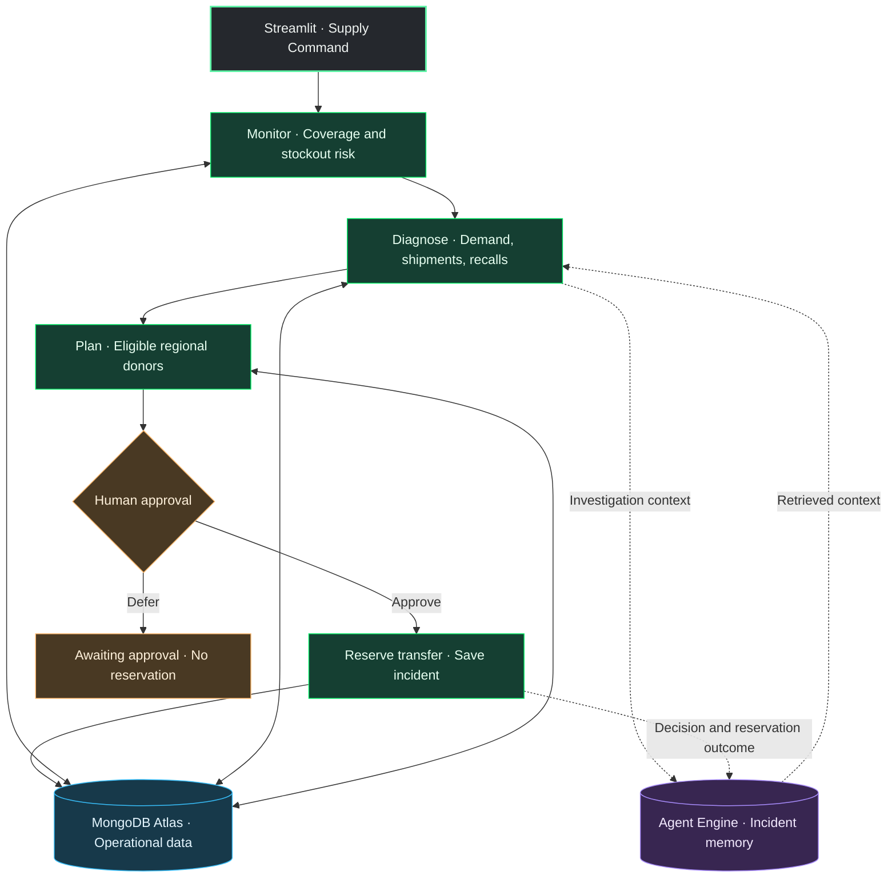

<div align="center">

# 💊 Pharma Supply Command

### Catch the shortage. Explain the disruption. Coordinate the response.

**MongoDB Atlas · Agent Engine · Streamlit**


*A pharmacy supply disruption becomes an actionable, human-approved response—with operational data and incident context behind every step.*

[The experience](#-the-experience) · [Quick start](#-quick-start) · [Demo walkthrough](#-the-three-minute-demo) · [Atlas under the hood](#-atlas-under-the-hood) · [Agent memory](#-give-the-next-investigation-some-context)

</div>

---

## 🟢 The experience

A hospital has **18 hours of drug supply left**. Its replenishment shipment is **72 hours away**.

Pharma Supply Command exposes the risk, investigates the disruption, evaluates nearby inventory, and proposes a transfer that preserves the donor facility’s supply. A person approves the reservation. The incident becomes reusable context for future investigations.

| 🔎 Detect | 🧩 Investigate | 📍 Coordinate | 🧠 Remember |
| :--- | :--- | :--- | :--- |
| Identify low inventory and shrinking coverage. | Inspect demand, shipment delays, and synthetic lot notices. | Find eligible donors and reserve a transfer after approval. | Capture incident context, decisions, and known outcomes. |

> **The story:** one operational workspace connects a supply signal to a documented decision, with Atlas holding the business state and Agent Engine memory preserving useful incident context.

## 🟣 How it fits together



**Integration boundary:** the supplied Streamlit app implements the operational workflow and Atlas tools. Agent Engine memory is connected separately in the extended demo. The diagram shows where that integration fits; the starter package does not install or configure the Agent Engine container. Its built-in historical-example lookup uses drug/cause metadata matching.

## 🟠 Pick your disruption

| Scenario | What changes | What the investigation reveals |
| :--- | :--- | :--- |
| 🚚 **Supplier delay** | Usable inventory drops; the shipment ETA moves to 72 hours. | The shipment arrives after projected depletion, so regional supply is evaluated. |
| 📈 **Demand surge** | Daily demand increases while inventory remains constrained. | Coverage contracts and the required replenishment quantity grows. |
| 🧪 **Lot recall** | A synthetic quality event quarantines most of the target stock. | Quarantined units are excluded from usable inventory; recalled donor lots are excluded from transfer options. |

**Simulated:** pharmacy events, recall notices, courier estimates, and delivery operations.  
**Real when connected:** Atlas reads, aggregation, geospatial lookup, incident persistence, and transactional reservation updates.

## 🔵 Quick start

### 1. Install and launch

Use Python 3.10 or newer. From the app package’s `pharma_stockout` directory:

```bash
python3 -m pip install -r requirements.txt
python3 -m streamlit run app.py
```

The app opens with seeded local data. No Atlas connection or model API key is required for the starter workflow.

### 2. Connect Atlas

Paste your connection string into the sidebar, or set it near the top of `app.py`:

```python
ATLAS_URI = "mongodb+srv://<username>:<password>@<cluster>/"
DATABASE_NAME = "pharma_stockout_demo"
```

Use a dedicated demo database, a database user with read/write and index-creation permissions, and an Atlas network access entry for the machine running Streamlit. Keep a credential-bearing copy of the app out of published repositories.

### 3. Click once to initialize

**Seed missing demo data** inserts missing fixtures and creates the app’s indexes.

- 🟢 Existing records and incident state are preserved.
- 🔵 Facility coordinates receive a `2dsphere` index.
- 🟣 Inventory receives a unique facility/drug index.
- 🟠 Incident timestamps and recall lookups receive supporting indexes.

Ordinary reruns do not invoke index creation. Local session data is separate from Atlas data and is not automatically migrated when a URI is added.

> **Keep the theme:** retain `.streamlit/config.toml` and launch from the project directory. It supplies the charcoal widget surfaces, light text, and mint-green accents.

## 🎬 The three-minute demo

| Step | On screen | What to say |
| :--- | :--- | :--- |
| **1 · Trigger** | Select **Chicago Medical Center → Cefazolin → Supplier delay**. Click **Simulate supply disruption**. | “We’ve introduced a supply disruption into a synthetic regional pharmacy network.” |
| **2 · Detect** | Show the selected drug’s **18 hours of coverage** and regional coverage chart. | “The application calculates usable supply after reservations and quarantine, so on-hand inventory alone doesn’t hide the risk.” |
| **3 · Investigate** | Open **Agent workflow** and click **Run monitoring & investigation**. Expand the tool results. | “The investigation checks the shipment, lot notices, and regional transfer options. Each tool’s input and result is visible.” |
| **4 · Recommend** | Review the proposed **135-unit transfer** and donor choices. | “The recipient needs 135 units to reach three days of coverage after delivery. Eligible donors retain at least three days themselves.” |
| **5 · Approve** | Choose a donor and click **Approve & reserve transfer**. | “Human approval commits the donor reservation and incident update together in Atlas.” |
| **6 · Remember** | Open **Incident history**; show the connected Agent Engine memory view separately. | “We preserve the findings and decision so a future investigation can retrieve relevant experience.” |

**A useful detail to call out:** approval reserves the donor’s inventory. It does not mark the recipient’s shipment as delivered or claim that the stockout has been avoided.

## 🍃 Atlas under the hood

### An operational model built around the workflow

**Database:** `pharma_stockout_demo`

| Collection | What it holds | Role in the demo |
| :--- | :--- | :--- |
| `inventory` | Facility/drug stock, demand, lot, reserved and quarantined quantities | Calculate coverage and reserve donor inventory |
| `facilities` | Facility names and GeoJSON coordinates | Identify nearby transfer sources |
| `drugs` | Drug names and categories | Drive the catalog and selections |
| `shipments` | Incoming quantities, supplier, ETA, and status | Explain replenishment gaps |
| `recalls` | Clearly labeled synthetic lot notices | Identify affected stock and exclude recalled donors |
| `incidents` | Findings, recorded tool results, candidates, decisions, and status | Preserve the investigation and reservation record |
| `memory` | Seeded historical incident summaries | Provide metadata-matched examples in the starter app |

The seed contains **6 facilities, 6 drugs, 36 inventory records, and 36 shipments**, plus historical examples and a recall fixture. Incidents accumulate as investigations run.

### Coverage is computed in the database

```javascript
[
  {
    $set: {
      available: {
        $subtract: [
          { $subtract: ["$on_hand", "$reserved"] },
          "$quarantined"
        ]
      }
    }
  },
  {
    $set: {
      days_supply: { $divide: ["$available", "$daily_demand"] }
    }
  },
  { $sort: { days_supply: 1 } }
]
```

### Location becomes part of the decision

Atlas `$geoNear` retrieves nearby facilities from their GeoJSON coordinates. Application rules then evaluate drug availability, lot notices, donor surplus, and estimated arrival time.

### Approval updates commit together

A PyMongo transaction updates the donor reservation and the incident’s approved state together. Approval rechecks the incident status, donor supply, recipient replenishment quantity, and donor recall status. A repeated approval cannot reserve the same incident twice.

## 🧠 Give the next investigation some context

Agent memory should preserve **what happened, what was decided, and what is known about the outcome**. Current inventory stays in operational collections and is queried again for each investigation.

| Write point | Useful memory |
| :--- | :--- |
| After investigation | Incident ID, facility, drug, observed coverage, disruption, and findings |
| After the human decision | Proposed donor, quantity, decision, and the user’s stated rationale if provided |
| After an outcome is confirmed | Reservation, dispatch, receipt, failure, or resolution—only to the level actually observed |

```json
{
  "incident_id": "INC-DEMO-001",
  "facility_id": "CHI",
  "drug_id": "DRG-01",
  "disruption": "Supplier delay",
  "summary": "Chicago had 18 hours of usable supply; the incoming shipment was 72 hours away.",
  "decision": "Approved regional transfer",
  "quantity": 135,
  "outcome": "Transfer reserved; delivery not yet confirmed",
  "source": "Synthetic demo"
}
```

**Retrieval example:** “Find previous supplier-delay incidents involving this drug or facility. What action was taken, and what outcome was confirmed?”

The app’s `pharma_stockout_demo.memory` collection is the seeded example store. The Agent Engine memory namespace is determined by the container configuration; it is not assumed to be the same collection. This demo does not claim vector retrieval for the starter lookup.

## 🟡 Rules that make the recommendation credible

| Rule | Demo value |
| :--- | :--- |
| Available stock | On hand − outbound reservations − quarantine |
| Risk threshold | Less than **2 days** of usable supply |
| Recipient target | **3 days** after delivery |
| Donor protection | At least **3 days** remaining after reservation |
| Search radius | **160 km** |
| Arrival constraint | Estimated arrival precedes projected depletion |
| Synthetic travel estimate | Straight-line distance × 1.3, at 45 km/hour, plus 30 minutes handling |

These are presentation rules for synthetic data. The ETA is not a live routing result, and the recall fixture is not a live FDA feed.

## 🛠️ Project layout

| File | Purpose |
| :--- | :--- |
| `app.py` | Streamlit UI, fixtures, Atlas access, investigation tools, and approval logic |
| `requirements.txt` | Python dependencies |
| `.streamlit/config.toml` | Native dark-gray theme and green accents |
| `README.md` | Setup, architecture, and demo walkthrough |

### Keep the demo moving

- **No Atlas data yet?** Click **Seed missing demo data** after connecting.
- **Connection failed?** Check the URI, database user, IP access list, and network path. The app reports the failure rather than silently switching to local mode.
- **An incident is already awaiting approval?** Complete its approval or choose another facility/drug pair before injecting another disruption there.
- **No eligible donors?** The incident requires escalation; the app does not invent a transfer option.
- **White widgets or unexpected colors?** Confirm the `.streamlit` directory was copied and launch from the app’s directory.

## 🚀 Where to take it next

- Add dispatch and receipt states to close the transfer lifecycle.
- Replace synthetic recall and shipment fixtures with approved source integrations.
- Retrieve semantically similar past incidents with embeddings and Atlas Vector Search.
- Move tool orchestration into Agent Engine as the integration expands.
- Compare suggested actions with confirmed outcomes across repeated incidents.

## 📚 References

- [MongoDB Atlas](https://www.mongodb.com/docs/atlas/)
- [MongoDB Atlas Agent Engine](https://www.mongodb.com/docs/agentengine/)
- [MongoDB geospatial queries](https://www.mongodb.com/docs/manual/geospatial-queries/)
- [PyMongo transactions](https://www.mongodb.com/docs/languages/python/pymongo-driver/current/crud/transactions/)
- [Streamlit theme configuration](https://docs.streamlit.io/develop/api-reference/configuration/config.toml)

---

<div align="center">

### 🟢 Operational data. 🟣 Persistent context. 🔵 Visible decisions.

**Built to show how a supply disruption becomes a coordinated response.**

</div>
