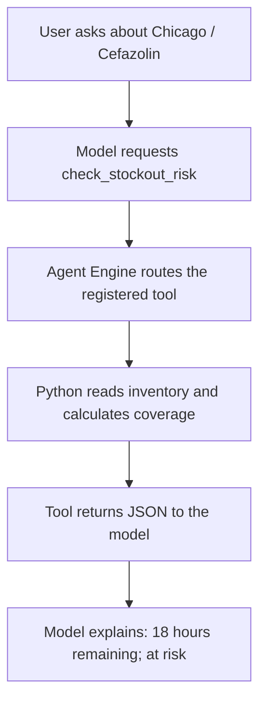

# 💊 One custom tool. One clear example.


**Question:** “Is Chicago running low on Cefazolin?”  
**Tool:** `check_stockout_risk(facility_id="CHI", drug_id="DRG-01")`  
**Result:** 45 usable units, 18 hours of supply, at risk.

This small addition to the Pharma Stockout repo demonstrates a custom Python tool registered with the Atlas Agent Engine SDK. It includes the actual agent graph, a sandbox configuration, and a deterministic inventory calculation. Start with the built-in sample; optionally connect the tool to the demo's Atlas inventory.

## 🟢 Start with the part that makes it a tool

In `stockout_agent/main.py`:

```python
app = App(app_name="pharma-stockout-tool")

@app.tool()
def check_stockout_risk(
    facility_id: str,
    drug_id: str,
    threshold_days: float = 2.0,
) -> str:
    """Check usable inventory and stockout risk for one facility and drug."""
    return json.dumps(check_stockout(facility_id, drug_id, threshold_days))
```

That is the registration. The business function calculates coverage; the decorator exposes the typed function through Agent Engine. Its name, description, and argument schema tell the model when and how to request it. Registration alone does not make the model call it: the graph connects the model to the registered tools.

## 🟣 Connect the tool to the agent

The complete runnable graph is in `main.py`. Its important lines are:

```python
# Tell the model what tools it may request.
llm = app.llm(ChatOpenAI(model="gpt-4o-mini"))
model_with_tools = llm.bind_tools(app.get_tool_schemas())

# Execute tool calls using Agent Engine's wrapped tools.
tool_node = ToolNode(app.get_tools())
```



`app.get_tool_schemas()` supplies descriptions and argument schemas for model tool selection. `app.get_tools()` supplies execution wrappers for `ToolNode`. Keep both SDK calls; substituting a direct function invocation in the graph bypasses this tool-execution path.

The graph checks whether the model returned a tool call. If it did, it executes the tool and sends the result back to the model. Otherwise, it finishes with the model's response.

## 🔵 Try the business function in 10 seconds

From this example directory, run:

```bash
python3 -m stockout_agent.stockout
```

This sample-only command needs Python 3.11+ and no third-party packages, database, API key, or Agent Engine container. It checks the business calculation; it does not exercise the agent runtime.

Expected fields:

```json
{
  "status": "ok",
  "source": "sample",
  "facility_id": "CHI",
  "drug_id": "DRG-01",
  "available_units": 45,
  "daily_demand_units": 60,
  "days_supply": 0.75,
  "hours_supply": 18.0,
  "threshold_days": 2.0,
  "risk_level": "at_risk"
}
```

The full result also includes the drug name, observation timestamp, and a synthetic-data label. A second fixture, `OAK / DRG-01`, has seven days of coverage and returns `covered`.

## 🟠 Run it as an Agent Engine agent

Use a **separate Agent Engine workspace** for this example. Keep the existing Streamlit application's environment and its existing agent/memory workspace intact.

1. Use your normal authenticated `agentengine create` / `agentengine init` workflow to prepare a Python agent workspace, or use a separate initialized workspace you already have. Retain its generated project identity and local runtime configuration.
2. Copy `stockout_agent/` into that workspace. Use the included `pyproject.toml` as a dependency reference and `agent.yaml` as the example agent configuration. When integrating into an existing agent, merge the relevant settings instead of replacing its whole manifest.
3. Use Python 3.11+ in this workspace. The SDK reference version is `agent-engine-sdk-langgraph==0.11.11`; use a compatible runner/container version. The agent dependencies belong in an isolated environment, not the legacy Streamlit/OpenAI environment.
4. Supply `OPENAI_API_KEY` through your existing Agent Engine local-secret setup or managed secret provisioning. `OPENAI_MODEL` is optional; the default is `gpt-4o-mini`. If overriding it through managed secrets, add its name under `sandboxes.tool.secrets`. The key must reach the **tool sandbox**. No actual credential is included in this package.
5. Validate, then start from the workspace directory:

```bash
agentengine agent validate
agentengine dev up
```

For a standalone local dependency environment, the included project can also be installed with `python3.11 -m venv .venv`, followed by `.venv/bin/python -m pip install -e .`. Dependency installation alone does not register or start an Agent Engine workspace.

Open the Playground URL printed by the CLI and ask:

> Use check_stockout_risk to check CHI / DRG-01 with a two-day threshold. Explain the usable units, hours of supply, and risk level. Identify whether this is sample or Atlas data.

Then ask:

> Compare that with OAK / DRG-01.

Look for the **`check_stockout_risk` tool invocation and returned JSON in the execution trace**, followed by the assistant's explanation. A plausible sentence without an invocation is not evidence that the tool ran.

### Where does it run?

The included `agent.yaml` assigns `check_stockout_risk` to `sandboxes.tool.tools`. That makes it a remote tool executed in the tool sandbox. It also lists `invoke_llm` there and supplies the model key to that sandbox. The agent sandbox runs the graph; the tool sandbox performs the tool/model work through the SDK wrappers.

By default, an unassigned `@app.tool()` function runs locally in the agent sandbox. The explicit manifest assignment demonstrates the separate tool sandbox. Sandbox-level secrets and egress are shared by tools in that sandbox; they are not per-tool isolation.

## 🍃 Optional: query the existing Atlas inventory

The default data source is the fixed sample. Configure the following values **in the tool runtime**, using your existing Agent Engine configuration/secret mechanism:

| Setting | Value |
| :--- | :--- |
| `PHARMA_DATA_SOURCE` | `atlas` |
| `PHARMA_ATLAS_URI` | Your own operational Atlas URI |
| `PHARMA_DATABASE` | `pharma_stockout_demo` (default) |

`PHARMA_ATLAS_URI` is deliberately separate from the platform's `MONGODB_URI`, which may point to execution-state storage. The tool makes one `find_one` call against `inventory`, filtered by facility and drug. It does not change data or create indexes. Seed the operational database using the original Streamlit app first.

Configure the appropriate Atlas cluster linkage/private network or approved egress path for the **tool sandbox**, plus Atlas database permissions and network access. Adding an Atlas hostname to ordinary egress is not a substitute for configuring Atlas access. Consult your workspace's supported `agentengine atlas` / `network.atlas_clusters` setup. The included manifest opens only the model endpoint; it does not assume your Atlas network configuration.

Add `PHARMA_DATA_SOURCE` and `PHARMA_ATLAS_URI` to `sandboxes.tool.secrets` when enabling Atlas. Add `PHARMA_DATABASE` too if overriding its default.

The same prompt now returns `source: "atlas"` and the actual current record. Newly seeded Atlas data is healthy; inject a disruption through Streamlit if you want a low-stock example. An Atlas failure returns an explicit error and never silently falls back to the sample.

## 🧩 Add just the tool to an existing agent

Copy `stockout_agent/stockout.py` into your agent package and add a wrapper to the module that owns your existing `app`:

```python
import json
from stockout_agent.stockout import check_stockout

@app.tool()
def check_stockout_risk(facility_id: str, drug_id: str, threshold_days: float = 2.0) -> str:
    """Check current usable drug inventory and stockout risk at a facility."""
    return json.dumps(check_stockout(facility_id, drug_id, threshold_days))
```

If you change the package path, update that import. Retain the existing `app`, entrypoint, graph, memory, and other tools. Ensure the graph binds `app.get_tool_schemas()` and executes `app.get_tools()`. Add the new tool name to the desired sandbox's manifest list; do not assign it to both sandboxes.

This is custom tool registration. The repo's separate `agent_memory.py` integration saves/retrieves incident memory and has a different purpose. This focused example does not add memory writes, transfer approvals, clinical recommendations, or an MCP server.

## ✅ Validation and troubleshooting

```bash
python3 -m unittest discover -s tests -v
```

Seven offline tests cover shortage, healthy/threshold cases, reservations, quarantine, unknown records, bad arguments, invalid inventory, and missing Atlas configuration. Registration/schema generation, registered function execution, and graph compilation were also checked with the actual SDK 0.11.11; model wrapping/checkpoint startup were stubbed for that local check. No live model request, container execution, or Atlas query was performed during authoring.

| Symptom | Check |
| :--- | :--- |
| Tool missing from the model | Wrapper module was imported and `app.get_tool_schemas()` is bound to the model. |
| Model answers without a tool call | Use the explicit prompt above and inspect the execution trace; verify the graph's tool-call branch. |
| Missing model key / model request fails | Secret is delivered to the tool sandbox; model is available to your account; provider egress is allowed. |
| Atlas lookup fails | Operational URI, database name, permissions, cluster linkage, and network path. |
| Record not found | Correct facility/drug IDs and the Streamlit seed step. Missing inventory means unknown risk, not zero stock. |
| Existing container rejects settings | Match your SDK, CLI, and runner versions; merge into the manifest supported by that deployment. |

**Math:** available = on hand - reserved - quarantined; days of supply = available / daily demand. A record is at risk when coverage is strictly below the requested threshold. Invalid inventory is reported as an error rather than guessed.

## 📚 Official references

Checked November 2, 2026:

- [Agent contract and tool registration](https://www.mongodb.com/docs/agentengine/reference/agent-contract/)
- [Python App SDK reference](https://www.mongodb.com/docs/agentengine/sdk/python/packages/agent-engine-sdk-langgraph/docs/api/)
- [Model/tool graph pattern](https://www.mongodb.com/docs/agentengine/add-features/remote-mcp/) — uses the same schema/execution plumbing; this example registers its own Python tool.
- [Run and test locally](https://www.mongodb.com/docs/agentengine/build/run-local/)
- [Network egress and Atlas access](https://www.mongodb.com/docs/agentengine/network-egress/egress-get-started/)
